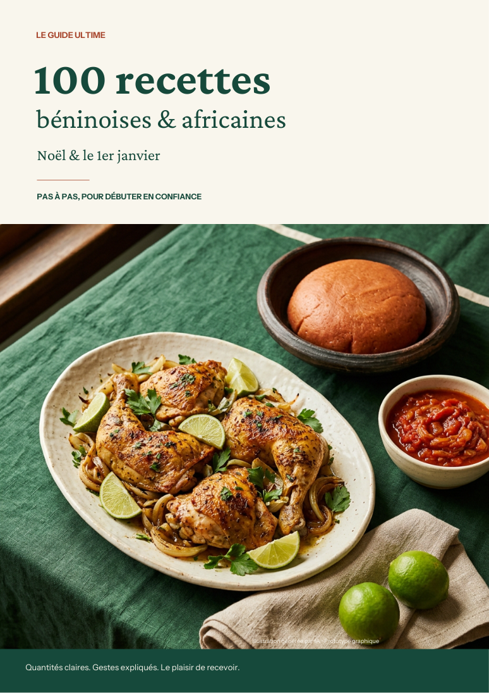

# Femme indépendante — livre de recettes

## Maquette « Terre de fête »

Prototype graphique de six pages du **Guide ultime des 100 recettes béninoises & africaines**, pour Noël et le 1er janvier.

📕 **[Ouvrir ou télécharger la maquette complète (PDF)](MAQUETTE-TERRE-DE-FETE-6-PAGES.pdf)**

Si GitHub ne montre pas le PDF, utilisez le bouton de téléchargement ou consultez les images ci-dessous.

### Couverture

### Les six pages en images

1. [Couverture](reports/maquette/page-1.png)
2. [Sommaire](reports/maquette/page-2.png)
3. [Ouverture du livre](reports/maquette/page-3.png)
4. [Recette : amiwo rouge](reports/maquette/page-4.png)
5. [Recette : poulet braisé au gingembre](reports/maquette/page-5.png)
6. [Recette : dèguè au mil et au yaourt](reports/maquette/page-6.png)

[Lire la direction artistique](DIRECTION-ARTISTIQUE.md)

**À noter :** cette maquette n’est pas le livre intégral. L’image culinaire est une illustration générée par IA, pas une photographie de recettes testées. Les conditions d’utilisation commerciale restent à vérifier avant publication. Les recettes n’ont pas été testées en cuisine dans le cadre de ce projet.
