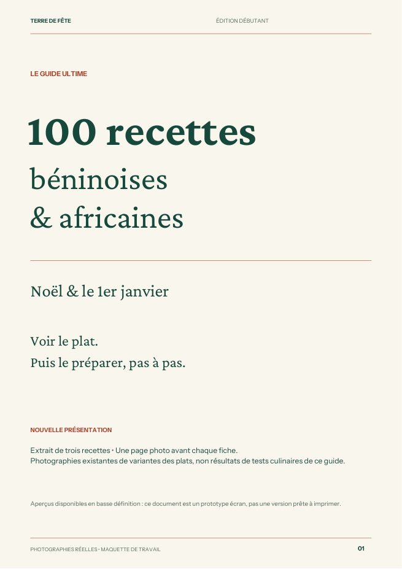

# Femme indépendante — livre de recettes

## Projet actuel : 100 recettes béninoises & africaines

Pour Noël et le 1er janvier, avec des explications adaptées aux débutants.

### Choix validés pour les prochaines éditions

- **Aucune image générée par IA**, y compris pour la couverture.
- **Une page de photographie réelle du plat terminé immédiatement avant chaque recette.**
- Vérification des sources, des licences et des crédits avant publication.
- Une photographie illustrative ne sera pas présentée comme le résultat exact d’une recette testée pour ce livre.

## Livre intégral mis en page — version de travail, 228 pages

📕 **[Consulter les 100 recettes dans le design validé](EBOOK-100-RECETTES-TERRE-DE-FETE-TRAVAIL.pdf)**

Le volume comprend les 100 fiches, un sommaire cliquable, les dix chapitres, les conseils pour débutants, les menus et les crédits. Une page photo est réservée immédiatement avant chaque recette.

**L’e-book n’est pas encore finalisé pour la vente : 14 aperçus photo intégrés, 86 emplacements à compléter et 0 photographie validée en haute définition pour publication finale.** Les pages manquantes sont explicitement signalées. Aucune photo IA ou photo d’un autre plat ne remplace les images absentes.

- [État de production et travail restant](FINALISATION-EBOOK.md)
- [Rapport technique](reports/ebook-complet/validation.json)
- [Script de génération](tools/construire_ebook_complet.py)
- [Liste des photographies à intégrer ou remplacer](recherche-photos/photographies-a-finaliser.csv)
- [Liens des originaux : 15 sources précédentes + 45 nouvelles pistes à vérifier](recherche-photos/LIENS-ORIGINAUX.md)
- [Tableau des liens et statuts pour les 100 recettes (CSV)](recherche-photos/liens-100-recettes.csv)
- [Liens sur d’autres sites pour les 40 recettes restantes](recherche-photos/LIENS-40-AUTRES-SITES.md)

**Recherche de liens actualisée :** 60 recettes ont un fichier original repéré, dont 45 nouvelles pistes non examinées visuellement. Les 40 autres restent sans original adapté identifié. Cela ne signifie pas que 60 photos sont validées ou intégrées : le livre reste à 14 aperçus et 86 photos manquantes.

La couverture et les fiches reprennent la maquette validée. Les recettes restent non testées en cuisine dans le cadre de ce projet.

## Maquette validée — photographies réelles uniquement

📕 **[Ouvrir ou télécharger la nouvelle maquette PDF (8 pages)](MAQUETTE-PHOTOS-REELLES.pdf)**

**Couverture corrigée : le design initial est rétabli**, avec les mêmes titres, polices, fond crème, emplacement de la grande image et bandeau vert. Seule l’illustration IA a été remplacée par une photographie réelle d’amiwo avec poulet (aperçu provisoire).

Trois extraits : **amiwo, poulet yassa et kelewele**. Chaque page photo précède immédiatement la recette correspondante. Aucune image générée par IA dans ce document.

**Il s’agit d’un prototype écran**, pas du livre complet : les photos sont des aperçus de travail en basse définition et montrent des variantes des plats. La sélection haute définition des 100 recettes reste à compléter. Les crédits et liens sources figurent sur les pages photo.

### Feuilleter sans ouvrir le PDF

1. [Couverture](reports/photos-reelles/page-1.png)
2. [Sommaire de l’extrait](reports/photos-reelles/page-2.png)
3. [Photo : amiwo](reports/photos-reelles/page-3.png)
4. [Recette : amiwo](reports/photos-reelles/page-4.png)
5. [Photo : poulet yassa](reports/photos-reelles/page-5.png)
6. [Recette : poulet yassa](reports/photos-reelles/page-6.png)
7. [Photo : kelewele](reports/photos-reelles/page-7.png)
8. [Recette : kelewele](reports/photos-reelles/page-8.png)

[Script de génération de cette maquette](tools/maquette_photos_reelles.py)

## Recherche de photos — premier lot (archive)

Le bilan historique ci-dessous ne comprend pas le second lot : **10 aperçus supplémentaires** ont été intégrés le 18 novembre 2026. Voir [le bilan actualisé](recherche-photos/LOT-2-PHOTOS.md).

📷 **[Consulter la sélection et les sources photographiques](recherche-photos/SELECTION-PHOTOS-REELLES.md)**

📋 [Voir le suivi structuré des 100 recettes](recherche-photos/suivi-100-recettes.json)

| État | Nombre |
|---|---:|
| Recettes suivies | 100 |
| Pistes de sources repérées (pas nécessairement des photos utilisables) | 29 |
| Pages de fichier dont la licence a été consultée | 5 |
| Miniatures de travail récupérées | 4 |
| Photos approuvées pour publication finale | 0 |
| Recettes restant sans recherche effectuée dans ce lot | 71 |

Les originaux haute définition restent à télécharger et à examiner. Certaines pistes montrent un ingrédient, une étape ou une autre variante : elles ne seront pas utilisées comme résultat final sans vérification.

### Quatre miniatures pour examen

Ces petites images sont des **candidates de recherche**, pas des illustrations finales de pleine page. Les auteurs, licences, sources et limites figurent dans le [dossier de sélection](recherche-photos/SELECTION-PHOTOS-REELLES.md).

| Recette | Aperçu | Auteur et licence de l’original |
|---|---|---|
| Amiwo avec poulet | [Voir](assets/food/previews/recette-011.jpg) | Aimeabibis — CC BY-SA 4.0 |
| Ablo | [Voir](assets/food/previews/recette-018.jpg) | Rayman3640 — CC BY-SA 3.0, licence choisie parmi celles proposées |
| Kelewele | [Voir](assets/food/previews/recette-004.jpg) | Maame1Yaa — CC0 1.0 |
| Poulet yassa | [Voir](assets/food/previews/recette-022.jpg) | KVDP — domaine public selon la page source |

[Registre de provenance et de droits](assets/food/registry.json)

## Guide textuel existant

- [Lire les 100 recettes](LE-GUIDE-ULTIME-100-RECETTES-BENINOISES-AFRICAINES.md)
- [Télécharger le PDF textuel de 62 pages](LE-GUIDE-ULTIME-100-RECETTES-BENINOISES-AFRICAINES.pdf)

Ce PDF ne contient pas encore la nouvelle présentation avec une photographie avant chaque recette. Les recettes n’ont pas été testées en cuisine dans le cadre de ce projet.

## Ressources de travail

- [Installation et limites des skills](ATELIER-EBOOK.md)
- [Consignes actuelles du projet](AGENTS.md)
- [Dépendances Python](requirements-editorial.txt)

## Ancienne maquette — obsolète et non approuvée

L’ancienne maquette de six pages comporte une image générée par IA. **Elle ne respecte plus le choix du client et ne constitue pas la version à publier.** Elle reste accessible uniquement pour conserver l’historique graphique ; ne pas l’utiliser comme présentation commerciale.

- [Ancien PDF — obsolète](MAQUETTE-TERRE-DE-FETE-6-PAGES.pdf)
- [Ancienne direction artistique](DIRECTION-ARTISTIQUE.md)

Aucune nouvelle image IA n’a été produite pour le dossier de recherche photographique.
